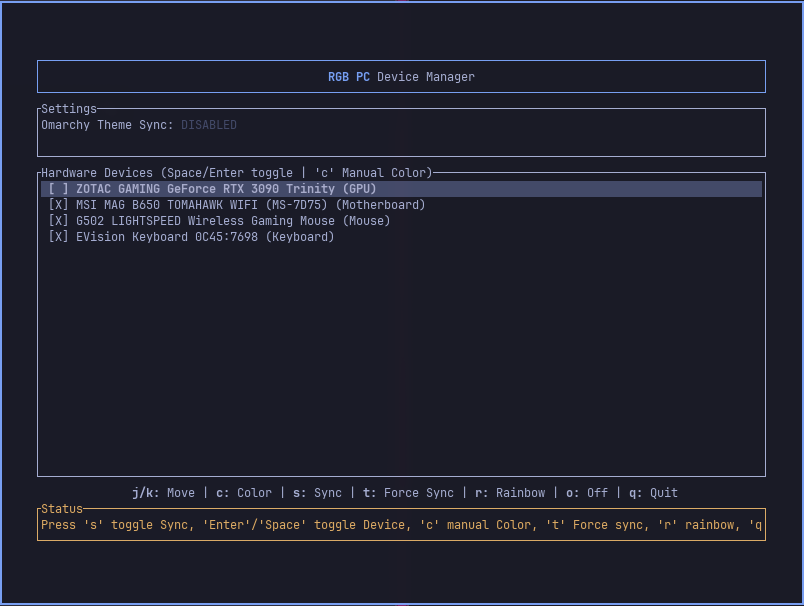

# RGBPC

A TUI application for managing your PC's RGB lighting via OpenRGB. Control all your devices, apply colors, and keep your setup looking clean — right from the terminal.

## Features

- **Device Management:** Auto-detects all OpenRGB-compatible RGB controllers. Easily enable or disable individual devices (useful for sensitive hardware like certain GPUs).
- **Manual Color Control:** Pick from a built-in palette or enter any custom HEX color, applied instantly to all enabled devices.
- **Rainbow Mode:** One key to set all enabled devices to a rainbow/spectrum cycle effect.
- **Fail-Safe Compatibility:** Tries multiple OpenRGB modes (`Direct`, `Static`, zone resizing) to maximize hardware compatibility.
- **Startup Restore:** Optionally restore the whole remembered device setup at login with a one-shot startup command, even if you only changed one device last time.
- **Omarchy Theme Sync** _(Omarchy users only)_: Automatically reads your `colors.toml` and syncs your current theme's accent color to all enabled devices. Omarchy Quattro's active-theme state layout is supported, with a fallback for Omarchy 3.x, and the one-click installer uses the modular `~/.config/omarchy/hooks/theme-set.d/rgbpc` hook.

## Installation

### From AUR (Recommended)

```bash
yay -S rgbpc
```

### Build from source

```bash
git clone https://github.com/Zeus-Deus/rgbpc.git
cd rgbpc
cargo build --release
sudo cp target/release/rgbpc /usr/local/bin/
sudo cp assets/rgbpc.desktop /usr/share/applications/
```

## Usage

Launch `rgbpc` from your terminal or application launcher. Use `j`/`k` to navigate devices, `Space`/`Enter` to toggle a device on or off for manual bulk actions, `a` to toggle startup restore, `c` to pick a color for all enabled devices, `o` to turn all enabled devices off, `r` for rainbow mode, and `q` to quit.

If you are on [Omarchy](https://omarchy.org), the app will also show a **Settings** panel where you can enable automatic theme sync — colors will update across your hardware whenever you switch themes. When both startup restore and Omarchy sync are enabled, login restore uses the current Omarchy theme instead of the last manual color.

For non-interactive use, `rgbpc --restore-last` runs the same startup restore path used by the autostart entry. Startup restore reapplies each remembered device's own last state instead of one shared global color. Failed non-interactive actions return a nonzero exit status.

### Automatic acceleration

Just run `rgbpc`. It automatically reuses a local OpenRGB server or starts a temporary one, detects hardware, and runs the **same compatibility commands in the same order**. If starting its own server fails, it falls back to standalone OpenRGB. An existing but unresponsive server produces an error instead of being bypassed with competing hardware detection. Both motherboard fallback passes and the settling delay remain. There is no learned per-device command cache and no parallel hardware access.

The first detection still takes time; subsequent changes in the same session avoid repeating it. RGBPC stops its own server on exit and leaves existing user-owned servers running. No permanent service is installed. Acceleration is transport-level, not specific to a case, motherboard, or fan brand; hardware support still comes from OpenRGB.

For servers supporting SDK v3 or later, solid-color actions also finish with a **capability-checked state confirmation** after the existing CLI commands. If necessary, RGBPC selects the advertised programmable color mechanism, sends the requested color, and reads the result back over the same connection before saving success. Device IDs, modes and color-slot counts come from fresh server metadata; no motherboard names, learned strategies or fixed LED counts are used for this finish. Unrelated brightness/speed settings are preserved, and no extra zone resizing or hardware-profile saves are introduced. Older SDKs and unsupported modes retain the CLI compatibility path.

This check runs only during an action—there is no new daemon or idle polling. A server-state mismatch is an error, not a saved successful color. A matching readback confirms OpenRGB's state, **not** independent observation of the physical LEDs.

The helper is **session-scoped**, not an always-running daemon: it stays available while the TUI is open and stops when RGBPC quits. A noninteractive color/sync/restore command stops its own helper when that command finishes. After a reboot, the next launch creates a fresh session; optional login restore is still a one-shot command. RGBPC never stops a server it did not start.

The TUI redraws only after input, resize, or an action result, not on a repeating repaint timer. Idle RGBPC does not repeatedly rediscover hardware. OpenRGB still occupies memory and may do its own background work while the session is open; resource usage depends on its build and detected devices, so it is not a zero-resource process.

The same automatic behavior applies to noninteractive commands, startup restore, and theme sync. Existing hooks need no extra flags. `--standalone` is a diagnostic escape hatch for the original direct CLI path; `--fast` remains accepted as a legacy alias for the default.

Hardware actions and device-list refreshes wait for the previous action to finish. Cooperating RGBPC processes sharing the user cache serialize complete actions, including delayed retries and saved-state updates, so an old retry cannot interleave with another action. This does not coordinate third-party lighting programs or older RGBPC builds. While busy, `q`/`Esc` shows a wait message; `Ctrl+C` restores the terminal and force-quits. A force quit can interrupt another client using the temporary server.

A newly started temporary server scans current hardware instead of loading a saved device roster. After changing hardware while RGBPC is open, or when reusing an existing server, press `R`: RGBPC restarts its own temporary server and rescans, or requests a capability-checked rescan from an existing server without stopping it. Older external servers that cannot confirm a rescan report a clear error rather than pretending the cached roster is fresh. Numeric device IDs are refreshed before writes; missing or ambiguous targets are rejected instead of reusing an old ID.

### Case and fan controllers

> Some case/fan controllers need **Motherboard / MB Sync** mode and a connected ARGB sync cable before software control works. Check the controller's manual—turning its lights off is not the same as selecting sync mode. RGBPC cannot reliably detect that physical switch setting through a motherboard ARGB header.

### Noninteractive commands

These commands work without opening the TUI:

| Command | Action |
|---|---|
| `rgbpc --list-devices` | List detected IDs, names, keys, and enabled status |
| `rgbpc --color 0080FF` | Set a solid color on all enabled devices |
| `rgbpc --off` | Turn enabled devices off |
| `rgbpc --rainbow` | Request a supported rainbow mode on enabled devices |
| `rgbpc --device 'EXACT DEVICE NAME' --color 0080FF` | Target one exact name, current ID, or key from the device list |
| `rgbpc --sync-theme` | Apply the current theme when theme sync is enabled |
| `rgbpc --restore-last` | Restore remembered states when startup restore is enabled |

`--device` can be repeated. Disabled devices are not silently overridden; missing or ambiguous selectors are errors. IDs may change after hardware detection, so use a unique listed key or exact name for repeated automation. Identical controllers sharing an identity cannot be targeted as a subset safely during compatibility retries.

In the TUI, `t` explicitly applies the current theme to the currently enabled devices, including after a manual color change. Automatic theme hooks still use their separately saved sync scope; a one-shot force sync does not silently add devices to that scope.

For automatic theme changes, use `s` to enable sync for the currently enabled devices. Choosing a manual color, off, or rainbow takes the affected devices out of automatic sync so future theme changes do not overwrite that manual choice. To put them back under automatic control, toggle sync off and on with `s`. Pressing `t` alone does not enable automatic tracking.

Add `--json` for scripts and automation, for example `rgbpc --list-devices --json` or `rgbpc --color 0080FF --json`. Output is one JSON object on stdout, with `schema_version: 1`; diagnostics use stderr. Direct color/off/rainbow and enabled theme-sync results include `ok`, `accepted_devices`, `errors`, and `verification: "command_acceptance"`. Success means command-level acceptance, **not** independent verification of physical LEDs.

Exit codes: **0** for success, **1** for an operation error or partial failure, **2** for invalid arguments. Disabled theme sync/startup restore is a successful no-op. Use `rgbpc --help` for the complete argument reference.

## Hyprland Window Rules

`rgbpc` uses `org.omarchy.RGBPC` as its window class so you can float and center it like a GUI app:

```conf
windowrule = float on, center on, size 800 600, match:initial_class org.omarchy.RGBPC
```
